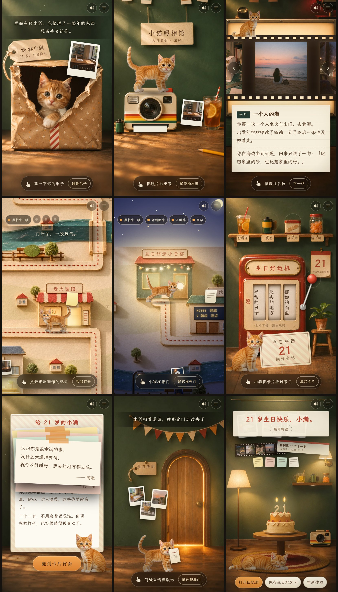

# 橘猫猫陪小满过 21 岁生日

**【AI 许愿第二日】** 一个送给朋友的 21 岁生日互动纪念 Web App：撕开包装纸，一只小橘猫从礼物盒里探出头，带着收礼物的人走过七幕——拆礼物、照相馆、一年的胶卷、小镇地图、好运小卖部、刮刮卡、生日房间，最后留下一本回忆册和一张可以保存的纪念卡。

这是它的**影视级版**：每一帧都按「先像一张电影剧照，然后才是一个网页」来做。代码、小猫的骨骼动画、文案和测试脚本由 Claude Fable 5.2 根据[一段愿望](docs/愿望原文.md)完成，画面由 Codex 出图。纯静态网页，无框架、无构建、无服务端。

**在线体验（手机打开最佳）：https://xiaojumao-film.godpenai.com**



九张单图在 [`docs/screenshots/`](docs/screenshots/)。

## 本地运行

只需要 [Node.js](https://nodejs.org)（18 以上），不用 `npm install`：

```bash
git clone https://github.com/Infinity-light/orange-cat-birthday-21.git
cd orange-cat-birthday-21
node tools/serve.mjs           # 然后打开 http://localhost:8331
```

端口被占用时换一个：`node tools/serve.mjs 9000`。

电脑浏览器打开后是居中的一条手机宽度画面；想看手机效果，用开发者工具的手机模拟，或让手机访问电脑的局域网地址。

- `?act=3` 可以直接进某一幕。
- `/cat-lab.html` 是小猫动作试验页，`/cat-test.html` 是小猫姿势表。

## 换成你自己的内容

名字、日期、照片、文字、地点、朋友留言、老虎机的愿望，全部集中在 [`app/js/content.js`](app/js/content.js) 一个文件里。

1. 把照片放进 `app/assets/photos/`（JPG / PNG / WebP 都行，竖图横图会自动居中裁切），在 `content.js` 里把对应的 `src` 改成文件名。
2. 从上往下改 `content.js`：`person`（名字、生日、署名）→ 各幕的文字 → `act6.notes`（朋友留言）。称呼「小满」除了 `person.nick` 还直接写在不少句子里，搜一下全部换掉。
3. 文字改完后重新生成字体子集，否则新出现的字会退回系统字体：`python tools/subset-font.py`（用法见脚本开头）。

## 仓库结构

```
app/                网页本体（纯静态，发布这个目录即可）
  index.html
  js/content.js     ★ 所有可替换的内容
  js/main.js        七幕顺序、转场、目录、进度保存
  js/acts/          act1..7.js 七幕；album.js 回忆册和纪念卡
  js/cat/           小猫：rig.js 骨骼与贴毛皮、clips.js 动作数据、cat.js 控制器
  js/audio.js       背景音乐与音效（WebAudio 现场合成，没有音频文件）
  css/cinema.css    这一版的全部画面改动
  assets/           场景底图、小猫分层、示例照片、字体子集
prompts/            24 张生成图的提示词
gen/                Codex 生成的原图（未裁切、未压缩）
layers/             抠好的分层素材：小猫各部位、第一幕、第四幕
style/              定调：原版截图、Codex 影视级定调图、并排对比
compare/            逐幕新旧对比（与 2D 原版同一时刻、同一尺寸）
tools/              本地服务器、出图、抠图、切层、走查、录屏脚本
docs/
  愿望原文.md       七幕内容的全部需求，一字未改
  创作简报.md       这一版要做成什么样
  制作说明.md       每一轮改了什么、哪些幕到了「电影剧照」哪些没到、没做和没验证的
  制作成本.md       TOKEN 用量与折算费用
  screenshots/      九张截图和九宫格总览
```

没有放进仓库的：一千多张过程截图、完整演示录屏（约 243 MB）、字体源文件（约 19 MB）。

## 它是怎么做出来的

这个项目先有一个 2D 绘本风的原版（同一天由 Claude Fable 5.2 做完，线上 https://xiaojumao.godpenai.com ，源码不在本仓库）。许愿人觉得动线和流畅感已经够了，但画面还没有影视级的质感，于是有了这一版：

1. **定调**：从原版截一张「小猫探头」，交给 Codex 生成影视级版本，定下午后暖光、墨绿灰泥墙、木桌面、浅景深、胶片颗粒。之后每一幕的底图都带着这张定调图一起生成。见 [`style/`](style/)。
2. **小猫**：蓝幕上生成一只侧身站立的小猫，抠蓝、切成躯干、头、前后腿、尾巴，再沿原版的骨骼把毛皮一条条贴上去——骨骼、关节和全部动作数据沿用原版。
3. **七幕**：背景、10 张示例照片全部重新生成；撕纸、胶卷、刮刮卡这些交互仍然由代码按手指位置实时计算。
4. **打光**：按每一幕的主光方向给小猫亮面、暗面和影子朝向。

过程和取舍见 [`docs/制作说明.md`](docs/制作说明.md)。已知的短处也照实写在里面，最主要的一条：**没有在任何真手机上验证过**，所有检查都是电脑上的浏览器模拟。

成本：影视级版约 3159 万 TOKEN，按官方公开价折算约 165 元；连同它所基于的原版，两版合计约 1.56 亿 TOKEN、约 603 元。明细和口径见 [`docs/制作成本.md`](docs/制作成本.md)。

## 素材是怎么来的（脚本）

下面的脚本需要 Python（`pip install pillow numpy opencv-python rembg`）；`gen.py` 还需要本机装有并登录了 Codex CLI，模型名写在脚本顶部，按你能用的改。`make-compare.py` 用了 Windows 自带的微软雅黑字体路径，其它系统上要改一下。

1. **生成**：`python -X utf8 tools/gen.py <名字> [--ref 参考图…] [--shape portrait|landscape|square|p23]`。它读 `prompts/<名字>.txt`，调 `codex exec` 出图，存到 `gen/<名字>.png`。批量用 `tools/genq.py`。
2. **定调图**：`gen/key-a1.png`，参考图是原版截图。
3. **小猫**：`tools/key.py` 抠蓝，`tools/cut-cat.py` 切层；坐姿和睡姿是另外生成的两张整图（`tools/prep-sprites.py`）。
4. **第一幕**：同一个构图生成了「合着的礼物」「撕开后空的礼物」两张对齐的底图；探头的小猫和爪子从定调图里抠出来（`tools/cut-a1.py`）。
5. **其它幕**：`tools/prep-plates.py` 把底图和照片压成网页用的尺寸；`tools/cut-a4.py` 把第四幕长椅上的叶子切成能拖动的一层（跑完 prep-plates 之后要再跑一次它）。
6. **对比图**：`tools/compare-shots.mjs` 和 `tools/make-compare.py`。其中 `refshots.mjs`、`refmap.mjs`、`compare-shots.mjs old` 是对着原版截图用的，需要 `BASE=https://xiaojumao.godpenai.com`。

## 走查脚本

需要 Playwright：在仓库根目录 `npm install`，再 `npx playwright install chromium`。脚本默认用本机已安装的 Chrome。截图写到 `shots/`（已在 .gitignore 里）。

```bash
node tools/serve.mjs &                                           # 先起本地服务器
node tools/walk-all.mjs                                          # 手机 390×844，从第一幕走到第七幕
DESKTOP=1 VW=1440 VH=900 TAG=d node tools/walk-all.mjs           # 桌面
BASE=https://xiaojumao-film.godpenai.com node tools/walk-all.mjs # 对着线上跑
node tools/a1-shots.mjs touch                                    # 第一幕真实触摸手势
```

## 素材来源与许可

- **示例内容全部虚构**：「林小满」「阿澈」、朋友留言、地点、日期、对话都是 AI 编的示例，不对应任何真实的人。
- **画面**：场景底图、示例照片和小猫毛皮由 Codex（内置出图工具）根据 [`prompts/`](prompts/) 里的提示词生成；小猫只按文字描述生成，没有用任何真实照片。示例照片里出现的人物是生成的，不是真人。
- **声音**：全部由 WebAudio 现场合成，没有音频文件。
- **字体**：[霞鹜文楷 LXGW WenKai](https://github.com/lxgw/LxgwWenKai) 的子集（只含用到的字），SIL OFL 1.1 许可，许可证全文见 [`app/assets/fonts/OFL.txt`](app/assets/fonts/OFL.txt)。
- **许可证**：代码和文档以 [MIT](LICENSE) 发布。仓库里由 AI 生成的图片同样按 MIT 提供；需要留意的是，AI 生成内容在不同法域下能否享有著作权并不确定。字体不在 MIT 范围内，按 OFL 1.1。
